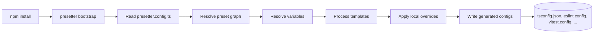
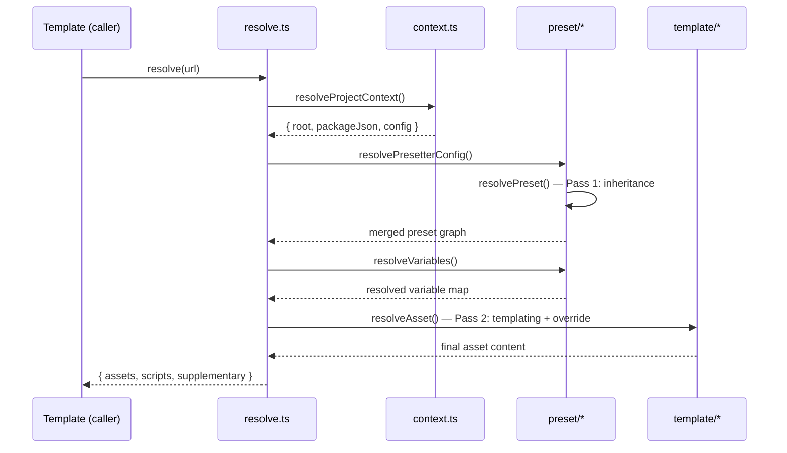
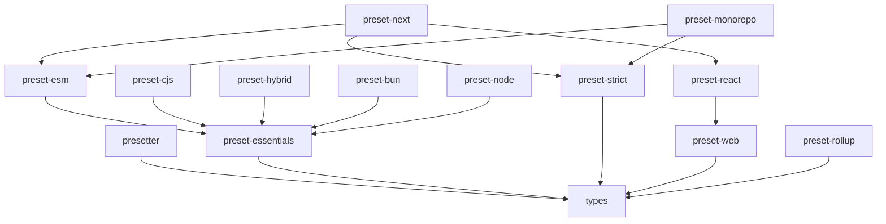
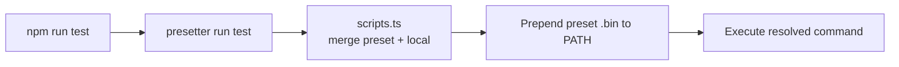
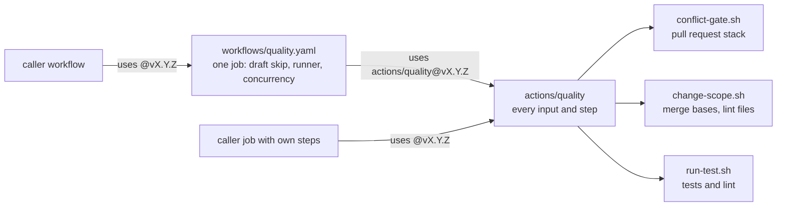

# 🏛️ Presetter Architecture

> A diagram-led tour of the Presetter engine, preset ecosystem, and monorepo topology. If you are new to the codebase, start here; if you are extending it, keep this open alongside `packages/presetter/src/`.

---

## 1. 🎯 Purpose & Scope

**Presetter** is split into two concerns that meet at bootstrap time:

- The **engine** (`packages/presetter`) is a template processor and script merger. It reads a project's `presetter.config.ts`, walks the `extends` graph of presets, resolves variables, processes templates, applies user overrides, and serialises the final assets to disk (`tsconfig.json`, ESLint config, Vitest config, `.gitignore`, etc.). It also composes `package.json` scripts and resolves preset-local binaries at runtime.
- **Presets** (`presets/*`) are pure content packages. They ship declarative `templates/`, `supplementary/`, `variables`, `scripts`, and optionally inherit from other presets. They are consumed by the engine; they never mutate the file system themselves.

This separation is the core architectural invariant: **engines process, presets declare**. Every feature below is a consequence of keeping that line clean.

---

## 2. 🗺️ Big-Picture Flow

What happens between `npm install` and a working dev environment:



Every arrow is a pure function in the engine: input comes from presets + user config, output is the next stage's input. The only side effect is the last step (`WR`).

---

## 3. 🧠 Two-Pass Resolution

The heart of the engine lives in `packages/presetter/src/resolve.ts`. Resolution is split into two passes so that inheritance can be computed independently of template substitution.



**How to read the passes:**

- **Pass 1 — inheritance.** `preset/resolvePreset` walks every `extends` edge depth-first, merging child preset content on top of parents. The output is a single flattened preset object; no `{variable}` tokens have been substituted yet.
- **Pass 2 — templating + override.** `template/substitute` replaces `{variable}` tokens in every asset using the resolved variable map, then `template/merge` applies any local `override` block from the caller. Templating runs _after_ inheritance so parents can define variables and children (or the end user) can redefine them.
- **Pass 3 — serialisation (implicit).** The caller (typically `executable/entry.ts bootstrap`) takes the result of `resolve` and writes it to disk via `serialization.ts` + `io.ts`. The engine core never writes files itself.

---

## 4. 📂 Repository Layout

```
presetter/
├── packages/        ← engine + shared types (published to npm)
├── presets/         ← official preset content packages
├── website/         ← Docusaurus documentation site (presetter.dev/presetter)
├── e2e/             ← end-to-end integration tests across real workspaces
├── examples/        ← minimal consumer projects used for manual sanity checks
└── assets/          ← logos, demo GIFs, before/after imagery for marketing
```

Everything shippable is in `packages/` and `presets/`. The other directories support development and documentation only.

---

## 5. 🎛️ Core Engine Modules

Files live under `packages/presetter/src/`. One-line gloss each:

| File               | Responsibility                                                          |
| ------------------ | ----------------------------------------------------------------------- |
| `index.ts`         | Public entry point; re-exports the stable API surface.                  |
| `context.ts`       | Locates project root and loads `package.json` + `presetter.config.ts`.  |
| `resolve.ts`       | Orchestrates the two-pass resolution pipeline.                          |
| `parsing.ts`       | Parses and normalises preset definitions (YAML, JSON, JS).              |
| `serialization.ts` | Serialises resolved assets back to the correct on-disk formats.         |
| `io.ts`            | Low-level file system helpers (read/write/diff).                        |
| `scripts.ts`       | Merges preset scripts with local `package.json` scripts.                |
| `run.ts`           | `run` / `run-s` / `run-p` command runner; resolves preset `.bin` paths. |
| `task.ts`          | Task graph and execution primitives used by `run.ts`.                   |
| `debugger.ts`      | Shared `debug` namespace for engine tracing.                            |

**Subsystems** (each has its own directory):

- `executable/` — CLI entrypoints. `entry.ts` wires `yargs` to the resolver; `error.ts` formats user-facing diagnostics.
- `preset/` — Preset-side concerns. `bootstrap.ts` drives `presetter bootstrap`, `project.ts` handles project-level metadata, `scripts.ts` merges preset scripts, plus `config/` and `resolution/` submodules.
- `template/` — Template processing. `merge.ts` implements the override merge algorithm; `substitute.ts` does `{variable}` interpolation.
- `utilities/` — Shared helpers (`display.ts`, `mapping.ts`, `object.ts`).

---

## 6. 🧩 Preset Anatomy

Every preset is a tiny npm package with a fixed shape:

```mermaid
flowchart TB
  subgraph P["@presetter/preset-<name>"]
    PJ[package.json<br/>peer deps + metadata]
    SRC[src/<br/>preset definition]
    TPL[templates/<br/>config templates]
    OVR[supplementary/<br/>override fragments]
  end
  BASE[@presetter/preset-essentials]
  P -. extends .-> BASE
```

A preset's `src/index.ts` is typically just a `preset()` call:

```typescript
import { preset } from 'presetter';
import essentials from '@presetter/preset-essentials';

export default preset('node', {
  extends: [essentials],
  variables: { target: 'ES2023' },
  scripts: {
    /* preset-defined lifecycle scripts */
  },
});
```

Nothing else is required — templates are discovered relative to the preset's package root.

---

## 7. 🌐 Package Dependency Graph

This is the authoritative dependency graph; other docs should link here rather than duplicate it.



**Edge legend:** `A --> B` means _A depends on B_ (either as `peerDependency`, `dependency`, or as a `preset.extends` target). `preset-essentials` is the de facto base for runtime/module-system presets; `preset-next` is a composite that fans in from `esm`, `strict`, and `react`.

---

## 8. 🏃 Runtime Topology

When a consumer runs a script, the engine sits on the execution path:



- `preset/scripts.ts` flattens preset-level scripts and composes them with the consumer's `package.json` scripts.
- `run.ts` resolves the target command, walks each preset's `node_modules/.bin`, prepends those directories to `PATH`, and spawns the process via `execa`. This is what lets presets ship their own `vitest`/`eslint` without hoisting.

---

## 9. 🧪 Testing & 📦 Release Topology

- **Unit tests** live next to source under `spec/` folders in each package (Vitest). Co-location keeps tests within arm's reach of the code under test.
- **End-to-end tests** live in `e2e/` and exercise real bootstrap flows against fixture workspaces.
- **Changelog generation** is driven by `cliff.yaml` (git-cliff) at the repo root, generated from the essentials preset's template. Its `tag_pattern` matches stable tags only, so prerelease tags never cap the next version or split the changelog.
- **Releases are lock-step and published from CI.** `npm run release:pr [-- <phase>.<n>]` prepares one release commit on `releases/next` and opens its pull request. Squash-merging it triggers [`release.yaml`](.github/workflows/release.yaml), which checks the merged tree against the pull request, tags, publishes with `pnpm publish -r` (npm trusted publishing; the phase name is the dist-tag for prereleases), and writes the GitHub Release.
- **Preview builds skip npm.** [`preview.yaml`](.github/workflows/preview.yaml) is dispatched by hand and attaches every public package as a tarball to a GitHub prerelease, with internal dependencies rewritten to the sibling tarball URLs. Both workflows also accept `workflow_call`.

### Shared quality gate

Presetter also ships a CI quality gate for pnpm repositories, as a composite action plus a thin reusable workflow:



- **The action owns everything.** [`actions/quality/action.yaml`](.github/actions/quality/action.yaml) declares every input and runs every step: the pull request conflict gate, checkout, pnpm and Node.js setup, registry auth and install, change-scope detection, tool cache restore, type check, unit/integration/end-to-end tests, lint with a drift check, and tool cache save. [`run-test.sh`](.github/actions/quality/run-test.sh) runs each test kind and lint as `pnpm run <script> -- [<changed-files-args> <files...>] <args> [--changed <commit>] <coverage args>`. The step scripts are plain bash, so [`spec/simulate.sh`](.github/actions/quality/spec/simulate.sh) runs them locally against a fake GitHub API, a throwaway pull request stack and a recording `pnpm`.
- **Conflicts stop a pull request before install.** On `pull_request`, [`conflict-gate.sh`](.github/actions/quality/conflict-gate.sh) reads the pull request through the REST API with `github.token`, polling briefly while `mergeable` is still `null`, and fails the job when it is `false`. It then walks down the stack: while the base isn't a stop branch (the default branch, plus any listed in `stack-stop-branches`, such as a git-flow `develop`) and an open pull request has that base as its head, it checks that layer the same way and moves to its base. The branch where the walk stops is the stack's final target, the `stack-target` output. Two open pull requests with one head branch, or a walk that revisits a pull request, fail the job, as the stack is then ambiguous or loops. An unread stack is not a checked one, so any API error fails the job with the API's message, and a 403 asks the caller for `pull-requests: read` unless the message names a rate limit; a `mergeable` that stays `null` only warns, as it is not a known conflict. `conflict-gate: false` skips the gate and its API reads.
- **Unit and integration tests scope to different bases.** [`change-scope.sh`](.github/actions/quality/change-scope.sh) computes two merge bases with `HEAD` (the `refs/pull/N/merge` commit): with `origin/<base branch>` for unit tests and lint, and with `origin/<stack target>` for integration tests, fetching either branch when the checkout lacks it. Unit tests run vitest `--changed <unit base>`, so a stacked layer tests only its own change; integration tests run `--changed <integration base>`, so they cover everything the stack brings to the trunk. The coverage run gets `--coverage.changed` with the same commit. Lint still receives the changed files since the unit base. A `full-run-paths` match in the pull request's own files, deletions and renames included, runs everything in full; one only in a lower layer runs just the integration tests in full. The fallback fetch can't authenticate on a private repository checked out with `persist-credentials: false`, so a missing merge base there means a full run. Every other event, `workflow_dispatch` included, runs in full.
- **The workflow is a wrapper.** [`workflows/quality.yaml`](.github/workflows/quality.yaml) is one job that skips draft pull requests, takes the runner as a label or a JSON `runs-on` value, and cancels superseded runs. Its job-level concurrency group, `<caller workflow>-quality-<ref>-<runner>-<node-version>`, keeps a caller's matrix legs apart and never equals the caller's usual `<workflow>-<ref>` group: a called workflow sees the caller's `github.workflow`, so an identical group would cancel the caller. Its single step calls `alvis/presetter/.github/actions/quality@vX.Y.Z`, passing through every action input except `checkout`. Callers with no steps of their own use the workflow; callers that need steps before install or after lint use the action.
- **Refs move with releases.** Callers pin a release tag. `release:pr` rewrites the wrapper's action ref to the version it releases and fails if the rewrite didn't match, so a tagged wrapper always runs the action of the same tag.
- **Presetter runs the local action, not the wrapper.** [`test.yaml`](.github/workflows/test.yaml) runs a three-OS matrix that type checks, tests and builds, without coverage or lint; [`coverage.yaml`](.github/workflows/coverage.yaml) collects unit coverage and uploads it to qlty; [`style.yaml`](.github/workflows/style.yaml) only lints. All three call `./.github/actions/quality`, so CI always runs the commit's own action. The wrapper's pin can't resolve until its tag exists, on a feature branch or a Release PR, so presetter's CI never calls it; it was checked with actionlint when written, and consumer repositories exercise it.
- **Callers own triggers and permissions.** The workflow sets no `permissions`, because a called workflow can only narrow the caller's grant: requiring `id-token: write` would fail callers that don't grant it, and `contents: read` alone would strip the `id-token` that OIDC callers grant. Callers that run on `pull_request` grant `pull-requests: read` for the conflict gate. The action sets no `concurrency`, and neither reads `vars`.

The consumer guide is [website/docs/advanced/continuous-integration.md](website/docs/advanced/continuous-integration.md).

---

## 10. 🔌 Extension Points

The smallest custom preset is a single file:

```typescript
import { preset } from 'presetter';

export default preset('my-preset', {
  variables: { source: 'src', output: 'dist' },
  scripts: { build: 'tsc', test: 'vitest' },
  assets: {
    'tsconfig.json': {
      compilerOptions: { target: 'ES2024', module: 'ESNext' },
    },
  },
});
```

From there you can:

- Add a `templates/` directory and reference files by relative path to take advantage of `{variable}` substitution.
- Set `extends: [somePreset]` to inherit from an existing preset; your declarations win on merge.
- Publish the package under the `@presetter/preset-*` convention (or any scope — the engine only cares about the exported default).

For the full type surface of `preset()`, `PresetDefinition`, variables, and override maps, see **[packages/types](packages/types)**.
